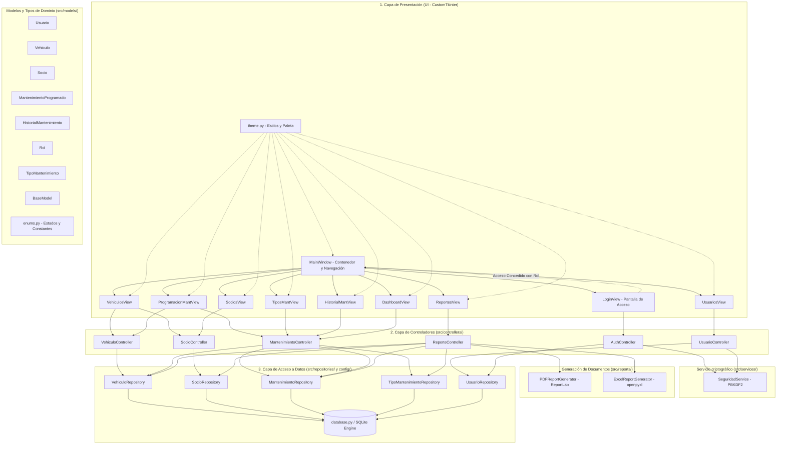
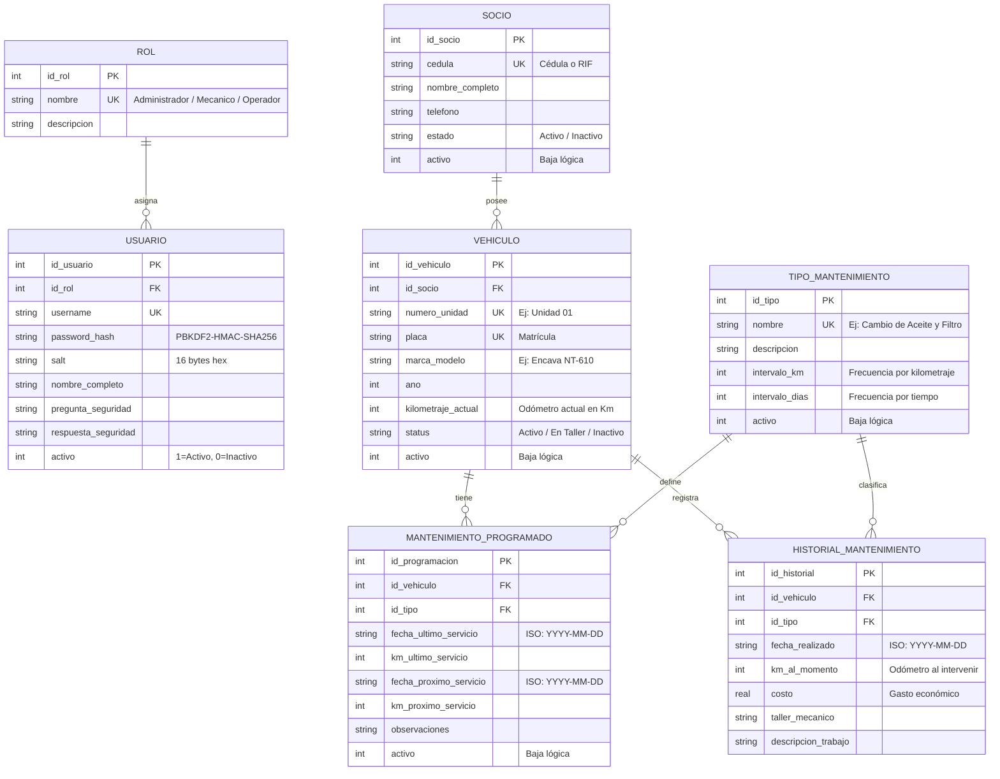

# 🏛️ Arquitectura y Estructura del Sistema

## Sistema de Control de Mantenimiento Preventivo — Brisas del Palmar

---

## 1. Visión General de la Arquitectura

El sistema sigue el patrón **MVC (Modelo - Vista - Controlador)** adaptado a una aplicación de escritorio, apoyado en una **arquitectura por capas**: Vista (`src/views/`) → Controlador (`src/controllers/`) → Repositorio (`src/repositories/`) → SQLite. Los modelos de dominio (`src/models/`) y la configuración (`config/`) son transversales.

> [!TIP]
> Todos los diagramas (MVC, UML de clases, ER, casos de uso, secuencia, estados, actividad, despliegue) están en [`DIAGRAMAS.md`](DIAGRAMAS.md). Este documento contiene la vista general de componentes.

> [!NOTE]
> `src/services/` es una **capa heredada (legacy)** de la versión 1.x. Las vistas ya no la usan: consumen controladores. Se conserva `SeguridadService` (activo, usado por `AuthController` y `UsuarioController`) y el resto de servicios solo se mantiene por compatibilidad con `tests/test_services.py`.



### Principios de Separación

1. **La Interfaz Visual (`src/views/`) NUNCA ejecuta sentencias SQL:** Su única función es renderizar componentes gráficos, capturar eventos de usuario y delegar las operaciones a los *Controllers*.
2. **Los Controladores (`src/controllers/`) orquestan las operaciones y aplican reglas de negocio:** Aquí residen las validaciones de entrada, verificación de unicidad, reactivación de registros dados de baja, cálculo del semáforo y orquestación transaccional. Devuelven tuplas `(ok, dato, mensaje)` o listas de modelos. Los permisos por rol se **definen** en `Usuario` y se **aplican** en las vistas.
3. **Servicio Criptográfico Centralizado (`src/services/seguridad_service.py`, única pieza activa de `services/`):** Encapsula el algoritmo PBKDF2-HMAC-SHA256 con sal aleatoria, normalización de preguntas de seguridad y comparación en tiempo constante.
4. **Los Repositorios (`src/repositories/`) aíslan el motor de datos:** Encapsulan todas las consultas SQL (`SELECT`, `INSERT`, `UPDATE`, `DELETE`) de forma parametrizada contra SQLite.
5. **Configuración y Transaccionalidad (`config/database.py`):** Centraliza la ruta del archivo de base de datos, claves foráneas (`PRAGMA foreign_keys = ON;`), migraciones automáticas y context managers para transacciones atómicas (`get_db_transaction()`).
6. **Modelos de Dominio Compartidos (`src/models/`):** Entidades POO con propiedades de negocio encapsuladas (ej. `usuario.es_admin`, `usuario.puede_modificar_flota()`), todas heredando de `BaseModel`.

---

## 2. Motor de Base de Datos (SQLite)

### ¿Por qué SQLite y no un servidor de base de datos externo?

- **Cero Configuración:** No requiere instalar ni mantener un servicio o demonio corriendo en segundo plano (evita los fallos clásicos de desconexión `Connection Refused` o error 2003 de MySQL).
- **Portabilidad Absoluta:** Toda la información de la empresa vive en un único archivo físico (`data/mantenimiento.db`). Respaldar el sistema completo se reduce a copiar este archivo.
- **Rendimiento Excepcional en Escritorio:** Al interactuar directamente mediante llamadas a la API de C de SQLite en el sistema de archivos local, se elimina la latencia de protocolos de red TCP/IP.
- **Integridad Referencial Garantizada:** Se activa explícitamente `PRAGMA foreign_keys = ON;` para forzar relaciones estrictas entre socios, vehículos y mantenimientos.

---

## 3. Modelo de Datos Relacional (7 Entidades Normalizadas en 3FN)

> La columna adicional `usuario.creado_en` existe en el esquema real; el diagrama completo con acciones `ON DELETE` está en [`DIAGRAMAS.md`](DIAGRAMAS.md#7-modelo-entidad-relación-base-de-datos).



### Reglas de Integridad

- **Protección de Socios:** La base de datos y la capa de servicios impiden la eliminación de un socio si tiene vehículos asociados (`ON DELETE RESTRICT`).
- **Cascada en Vehículos:** Un `DELETE` físico de un vehículo elimina sus programaciones **y su historial** (`ON DELETE CASCADE`). Por eso la aplicación usa **baja lógica** (`activo = 0`) y preserva la bitácora.
- **Tipos de mantenimiento:** no se pueden borrar físicamente si tienen historial (`ON DELETE RESTRICT`); borrarlos elimina sus programaciones (`CASCADE`).
- **Usuarios y roles:** un rol con usuarios no puede eliminarse (`RESTRICT`).
- **Unicidad compuesta:** `UNIQUE(id_vehiculo, id_tipo)` en `mantenimiento_programado`.
- **Unicidad:** El `username`, la cédula del socio, la placa y el número interno de unidad son únicos (`UNIQUE`).

---

## 4. Motor de Mantenimiento Preventivo y Semaforización

La lógica vive en `MantenimientoController.calcular_estado_alerta` (réplica heredada en `MantenimientoService`). El corazón del sistema evalúa simultáneamente dos variables de desgaste:

1. **Desgaste por Uso Físico (Kilómetros recorridos):** $\Delta_{\text{km}} = \text{km\_próximo} - \text{km\_actual}$
2. **Degradación por Tiempo (Días transcurridos):** $\Delta_{\text{días}} = \text{fecha\_próxima} - \text{fecha\_hoy}$

### Matriz de Estados de Alerta

| Estado | Indicador Visual | Condición Matemática | Acción Recomendada |
| :--- | :---: | :--- | :--- |
| **Vencido** | 🔴 Rojo | $\Delta_{\text{km}} \le 0$  ó  $\Delta_{\text{días}} \le 0$ | **Urgente:** La unidad debe ingresar al taller inmediatamente para evitar roturas mecánicas o multas operativas. |
| **Por Vencer** | 🟡 Amarillo | $1 \le \Delta_{\text{km}} \le 500$  ó  $1 \le \Delta_{\text{días}} \le 10$ | **Planificación:** Restan menos de 500 km o 10 días; preparar repuestos y agendar turno en taller. |
| **Al Día** | 🟢 Verde | $\Delta_{\text{km}} > 500$  y  $\Delta_{\text{días}} > 10$ | **Óptimo:** Unidad apta para operar en ruta regular. |

### Ciclo de Ejecución de Mantenimiento

Cuando el usuario registra un mantenimiento ejecutado en [`ProgramacionMantView`](../src/views/programacion_mant_view.py):

El proceso completo se ejecuta en **una sola transacción atómica** (`get_db_transaction()`, `BEGIN IMMEDIATE`) en `MantenimientoController.registrar_servicio_realizado` (ver diagrama de secuencia en [`DIAGRAMAS.md`](DIAGRAMAS.md#92-registrar-mantenimiento-realizado-transacción-atómica)). Si algo falla, se hace *rollback* completo.

1. Se crea un registro en `historial_mantenimiento` con fecha, taller, costo y detalles.
2. Si el odómetro ingresado es superior al odómetro registrado del vehículo, `vehiculo.kilometraje_actual` se actualiza automáticamente.
3. Se recalcula el próximo vencimiento:
   $$\text{km\_próximo} = \text{km\_servicio} + \text{intervalo\_km}$$
   $$\text{fecha\_próxima} = \text{fecha\_servicio} + \text{intervalo\_días}$$
   (mediante `upsert_programacion`, respetando `UNIQUE(id_vehiculo, id_tipo)`).
4. El semáforo vuelve automáticamente a 🟢 **Al Día**.

---

## 5. Estructura de Directorios del Código

```text
PROYECTO-MANTENIMIENTO/
├── assets/                          # logo_empresa(.png/_dark/_light), icono_empresa.png
├── config/
│   ├── __init__.py
│   └── database.py                  # Conexión SQLite, init_db(), migraciones, get_db_transaction()
├── data/
│   ├── mantenimiento.db             # BD SQLite (auto-generada en la 1ra ejecución)
│   └── test_mantenimiento.db        # BD aislada para pruebas
├── database/
│   ├── schema.sql                   # DDL: 7 tablas e índices
│   ├── seeds.sql                    # Roles, usuarios, 10 rutinas + socios, flota, programaciones e historial de demostración
│   └── seed_data.py                 # Script de hidratación de datos de prueba (--reset)
├── docs/
│   ├── README.md                    # Índice de documentación
│   ├── ARQUITECTURA.md              # Este documento
│   ├── DIAGRAMAS.md                 # Catálogo completo de diagramas (MVC, UML, ER, secuencia...)
│   ├── GUIA_INSTALACION_Y_USO.md    # Instalación y manual de usuario
│   ├── LOGIN.md                     # Autenticación y seguridad
│   └── guia-principiantes/          # Guía 00-INDICE … 08-GLOSARIO
├── src/
│   ├── models/                      # Dominio: BaseModel, Usuario, Rol, Socio, Vehiculo,
│   │                                #   TipoMantenimiento, MantenimientoProgramado,
│   │                                #   HistorialMantenimiento (mantenimiento.py), enums.py
│   ├── controllers/                 # BaseController, Auth, Usuario, Socio, Vehiculo,
│   │                                #   Mantenimiento, Reporte
│   ├── repositories/                # Usuario, Socio, Vehiculo, TipoMantenimiento, Mantenimiento
│   ├── services/                    # seguridad_service.py (activo) + servicios legacy
│   │                                #   (autenticacion, socio, vehiculo, tipo_mantenimiento, mantenimiento)
│   ├── reports/                     # pdf_generator.py (ReportLab), excel_generator.py (openpyxl)
│   └── views/                       # CustomTkinter
│       ├── theme.py                 # Paleta, tipografía y estilos Treeview
│       ├── main_window.py           # Ventana principal, sidebar, navegación y logout
│       ├── login_view.py            # Inicio de sesión
│       ├── recuperar_password_modal.py
│       ├── dashboard_view.py        # KPIs y alertas críticas
│       ├── vehiculos_view.py        # Flota y odómetro
│       ├── socios_view.py           # Socios y propietarios
│       ├── programacion_mant_view.py# Semáforos y registro de servicios
│       ├── tipos_mant_view.py       # Catálogo de rutinas
│       ├── historial_mant_view.py   # Bitácora y costos
│       ├── reportes_view.py         # Centro de reportes
│       ├── modal_filtros_reporte.py # Filtros de reportes
│       └── usuarios_view.py         # Gestión de usuarios (solo Admin)
├── tests/
│   ├── test_services.py             # 3 pruebas (capa legacy)
│   ├── test_sistema_integral.py     # 8 pruebas (seguridad, roles, soft delete, reportes, recuperación)
│   └── test_reportes_filtros.py     # 10 pruebas (filtros de reportes)
├── CHANGELOG.md
├── main.py                          # Punto de entrada
├── requirements.txt                 # customtkinter, reportlab, openpyxl, pillow
├── .gitignore
└── README.md
```
