# 📐 Catálogo de Diagramas del Sistema

## Sistema de Control de Mantenimiento Preventivo — Brisas del Palmar

Este documento reúne **todos los diagramas** del proyecto (MVC, capas, UML de clases, ER, casos de uso, secuencia, estados, actividad y despliegue). Están escritos en [Mermaid](https://mermaid.js.org/), por lo que se visualizan directamente en GitHub, VS Code (extensión Markdown Preview Mermaid) y la mayoría de visores Markdown.

> [!NOTE]
> Los diagramas reflejan el código real de `src/`, `config/` y `database/` (verificado contra el repositorio). Si cambias la estructura, actualiza este archivo y [`ARQUITECTURA.md`](ARQUITECTURA.md).

> [!TIP]
> Versiones en imagen (PNG alta resolución y SVG vectorial, fondo blanco) para tesis: carpeta [`imagenes-diagramas/`](imagenes-diagramas/README.md).

## Índice

| # | Diagrama | Tipo |
|---|---|---|
| 1 | [Patrón MVC](#1-patrón-mvc) | Arquitectura |
| 2 | [Arquitectura en capas y dependencias](#2-arquitectura-en-capas-y-dependencias) | Paquetes / componentes |
| 3 | [UML de clases — Modelos de dominio](#3-uml-de-clases--modelos-de-dominio) | UML clases |
| 4 | [UML de clases — Controladores, Repositorios y Servicios](#4-uml-de-clases--controladores-repositorios-y-servicios) | UML clases |
| 5 | [UML de clases — Vistas](#5-uml-de-clases--vistas) | UML clases |
| 6 | [UML de clases — Generación de reportes](#6-uml-de-clases--generación-de-reportes) | UML clases |
| 7 | [Modelo Entidad-Relación](#7-modelo-entidad-relación-base-de-datos) | ER |
| 8 | [Casos de uso por rol](#8-casos-de-uso-por-rol) | UML casos de uso |
| 9 | [Secuencia: inicio de sesión](#91-inicio-de-sesión) | UML secuencia |
| 10 | [Secuencia: registrar mantenimiento realizado](#92-registrar-mantenimiento-realizado-transacción-atómica) | UML secuencia |
| 11 | [Secuencia: generar reporte](#93-generar-un-reporte-con-filtros) | UML secuencia |
| 12 | [Secuencia: recuperar contraseña](#94-recuperación-de-contraseña) | UML secuencia |
| 13 | [Estados del semáforo](#10-máquina-de-estados-del-semáforo-preventivo) | UML estados |
| 14 | [Actividad: arranque de la aplicación](#11-diagrama-de-actividad-arranque-de-la-aplicación) | UML actividad |
| 15 | [Navegación de la interfaz](#12-mapa-de-navegación-de-la-interfaz) | Flujo |
| 16 | [Despliegue](#13-diagrama-de-despliegue) | UML despliegue |

---

## 1. Patrón MVC

El proyecto aplica **MVC** adaptado a una aplicación de escritorio. La capa **Modelo** se compone de las entidades de dominio (`src/models/`) y del acceso a datos (`src/repositories/` + `config/database.py`). Las **Vistas** nunca tocan SQL; los **Controladores** validan, aplican reglas y orquestan.

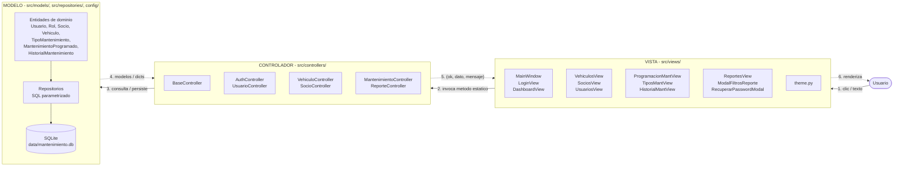

### Responsabilidad de cada componente MVC

| Componente | Carpeta | Responsabilidad | Prohibido |
|---|---|---|---|
| **Modelo** | `src/models/`, `src/repositories/`, `config/` | Entidades, reglas de dominio (permisos de `Usuario`), SQL y transacciones | Conocer la UI |
| **Vista** | `src/views/` | Dibujar widgets, capturar eventos, mostrar mensajes y aplicar visibilidad por rol | Ejecutar SQL |
| **Controlador** | `src/controllers/` | Validar entradas, reglas de negocio (semáforo, unicidad, reactivación), orquestar transacciones, devolver `(ok, dato, mensaje)` | Dibujar widgets |

---

## 2. Arquitectura en capas y dependencias

Dependencias **reales** de importación (verificadas en el código). Observa que `src/services/` es una **capa heredada (legacy)**: la aplicación ya no la usa (las vistas llaman a controladores); solo se conserva `SeguridadService` (activo) y el resto se mantiene por compatibilidad con `tests/test_services.py`.

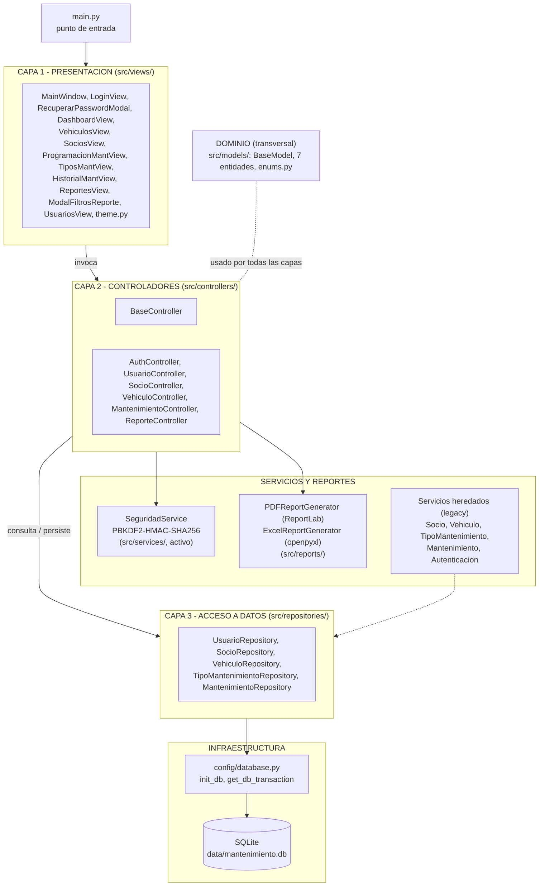

**Reglas de dependencia:** `Vista → Controlador → Repositorio → config → SQLite`. Las flechas nunca van en sentido contrario. `models` es transversal (lo usan todas las capas, no depende de ninguna).

---

## 3. UML de clases — Modelos de dominio

Archivos: `src/models/*.py`. Todos los modelos heredan de `BaseModel` (clase abstracta) y se construyen con `from_dict()`.

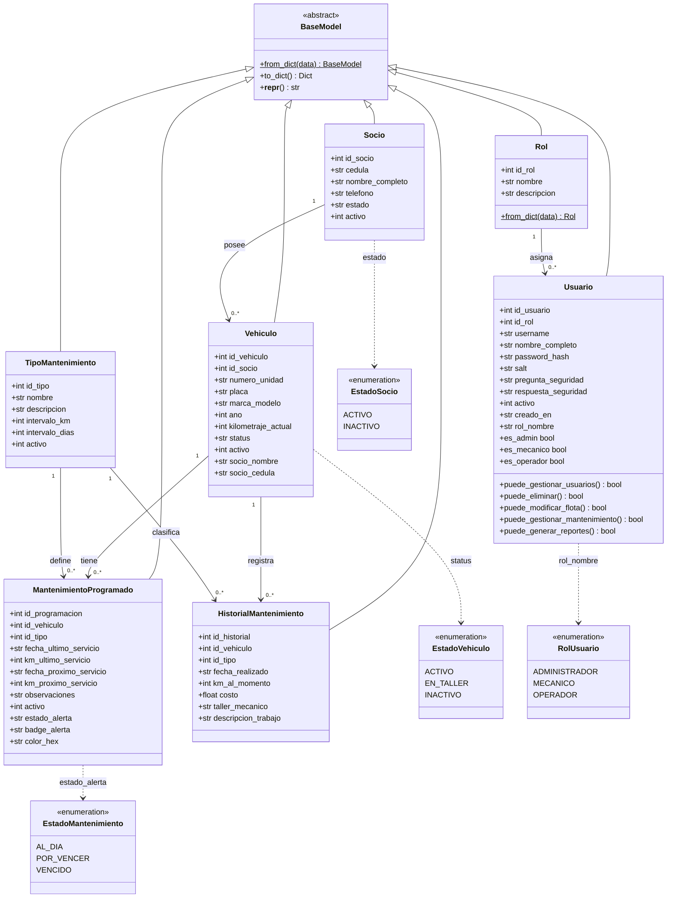

> [!NOTE]
> Los atributos de `Vehiculo`, `MantenimientoProgramado` e `HistorialMantenimiento` incluyen campos derivados de `JOIN` (`socio_nombre`, `placa`, `tipo_nombre`, etc.) que no son columnas propias de su tabla.

---

## 4. UML de clases — Controladores, Repositorios y Servicios

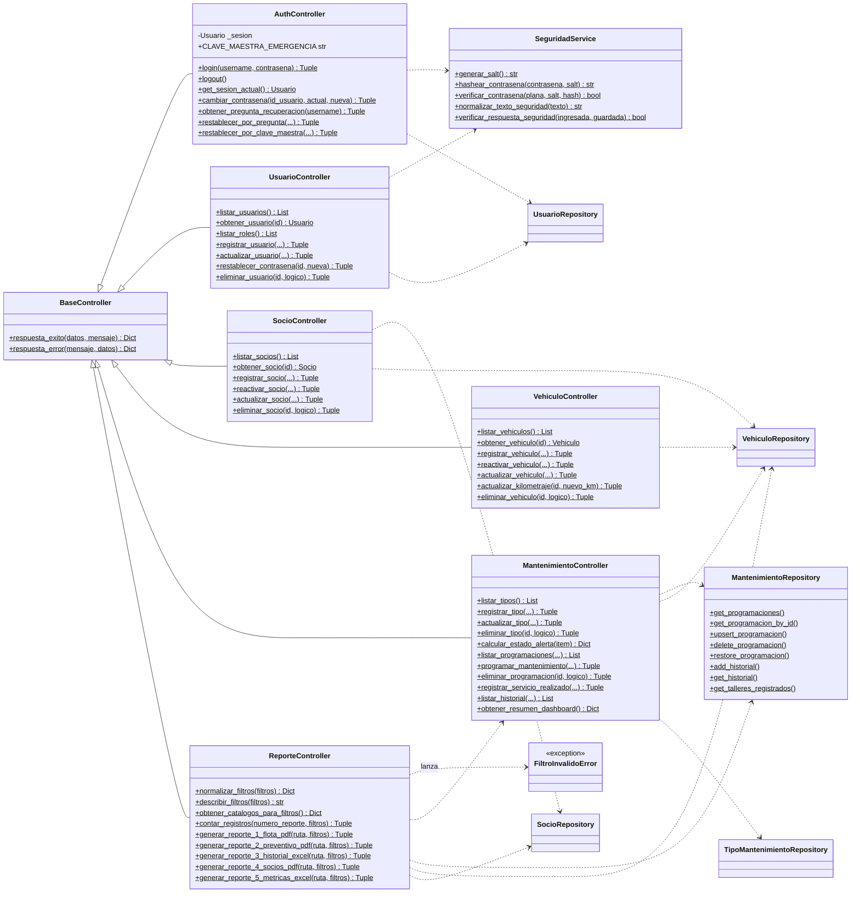

### Capa de servicios heredada (legacy)

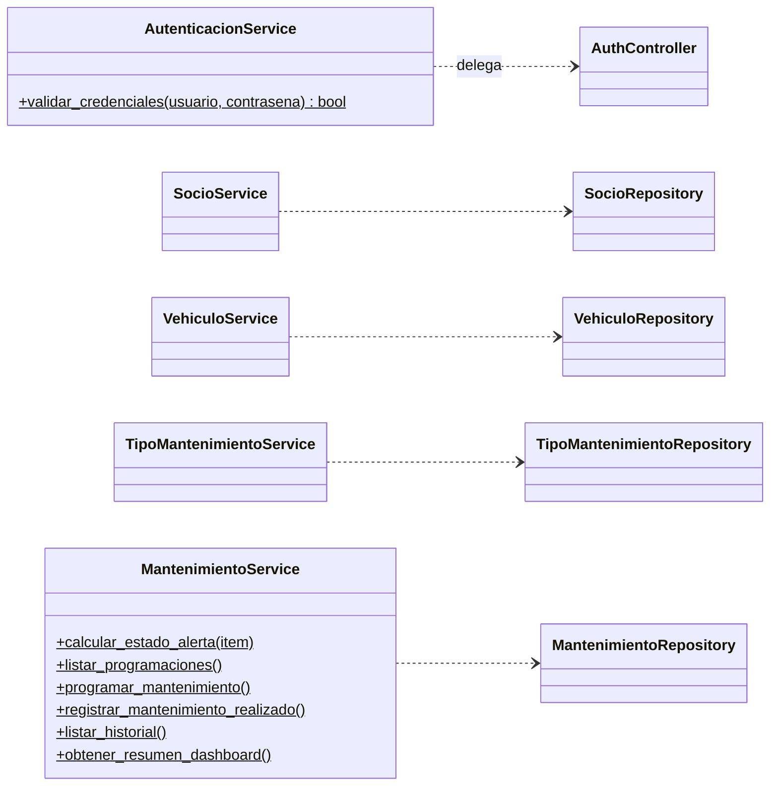

---

## 5. UML de clases — Vistas

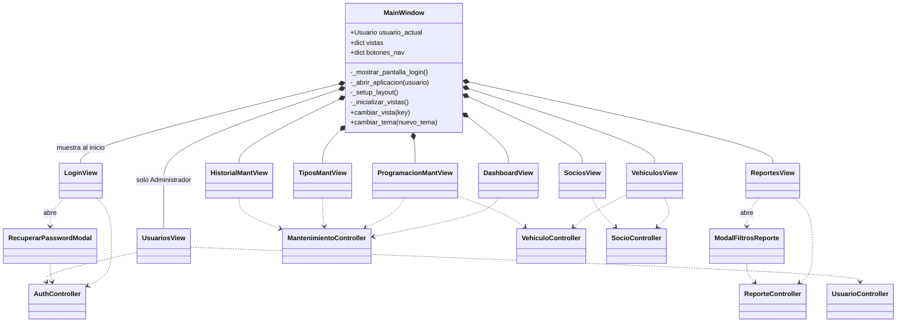

---

## 6. UML de clases — Generación de reportes

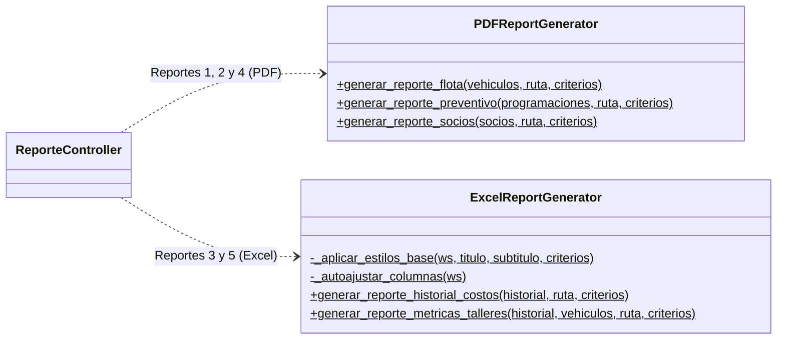

| Reporte | Formato | Generador |
|---|---|---|
| 1. Ficha Técnica y Estado de Flota | PDF | `PDFReportGenerator.generar_reporte_flota` |
| 2. Plan Preventivo y Alertas | PDF | `PDFReportGenerator.generar_reporte_preventivo` |
| 3. Bitácora Histórica y Costos | Excel | `ExcelReportGenerator.generar_reporte_historial_costos` |
| 4. Directorio de Socios y Unidades | PDF | `PDFReportGenerator.generar_reporte_socios` |
| 5. Métricas por Taller | Excel | `ExcelReportGenerator.generar_reporte_metricas_talleres` |

---

## 7. Modelo Entidad-Relación (base de datos)

Definido en [`database/schema.sql`](../database/schema.sql): 7 tablas en 3FN, con `PRAGMA foreign_keys = ON`.

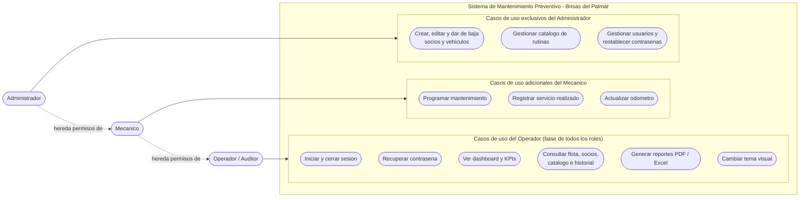

> [!NOTE]
> Restricción compuesta: `UNIQUE(id_vehiculo, id_tipo)` en `mantenimiento_programado` (una programación por unidad y rutina). Existen 15 índices de búsqueda (`idx_*`) sobre `username`, `cedula`, `placa`, `numero_unidad`, `activo`, etc.

---

## 8. Casos de uso por rol

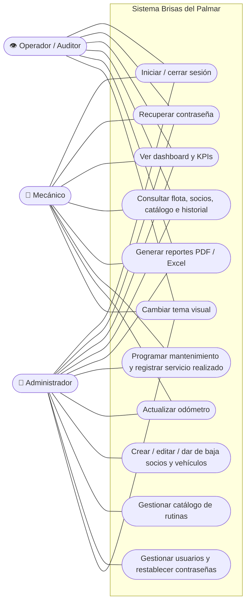

| Capacidad | Administrador | Mecánico | Operador |
|---|:---:|:---:|:---:|
| Dashboard, consulta, reportes (`puede_generar_reportes`) | ✅ | ✅ | ✅ |
| Programar / registrar mantenimiento (`puede_gestionar_mantenimiento`) | ✅ | ✅ | ❌ |
| Modificar flota y socios (`puede_modificar_flota`) | ✅ | ❌ (solo odómetro) | ❌ |
| Eliminar / dar de baja (`puede_eliminar`) | ✅ | ❌ | ❌ |
| Gestionar usuarios (`puede_gestionar_usuarios`) | ✅ | ❌ | ❌ |

> [!NOTE]
> Los permisos se **definen** en `Usuario` (modelo) y se **aplican** en las vistas (habilitando/ocultando controles, y creando `UsuariosView` solo para el Administrador). Revisa `vehiculos_view.py`, `programacion_mant_view.py` y `tipos_mant_view.py` para el detalle fino del rol Mecánico.

---

## 9. Diagramas de secuencia

### 9.1 Inicio de sesión

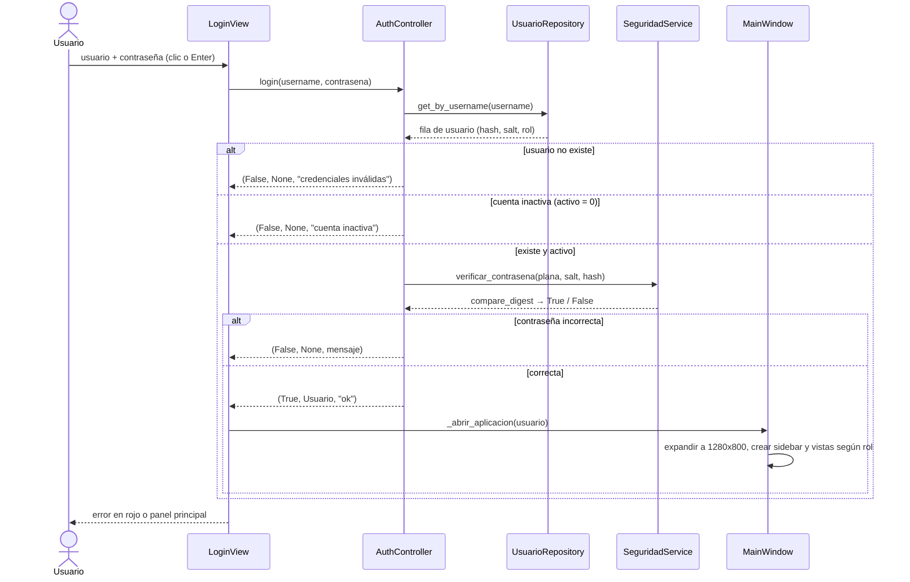

### 9.2 Registrar mantenimiento realizado (transacción atómica)

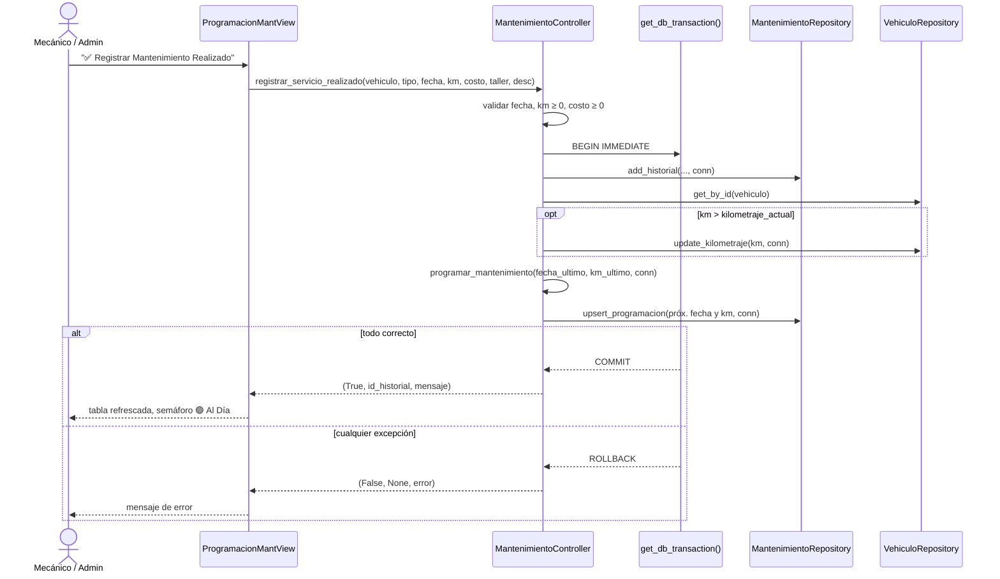

### 9.3 Generar un reporte con filtros

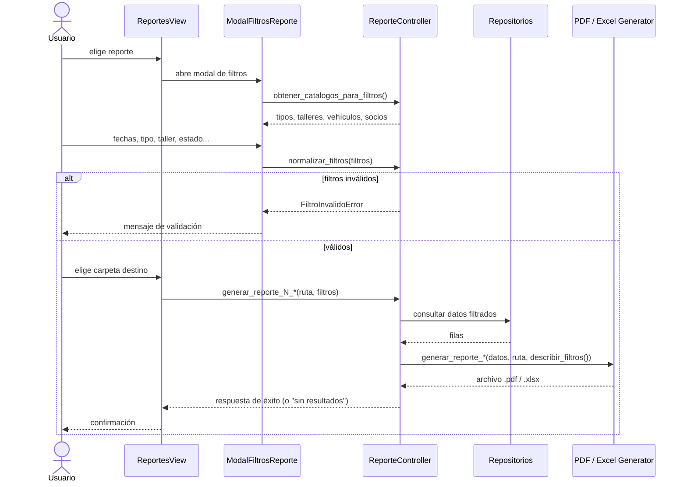

### 9.4 Recuperación de contraseña

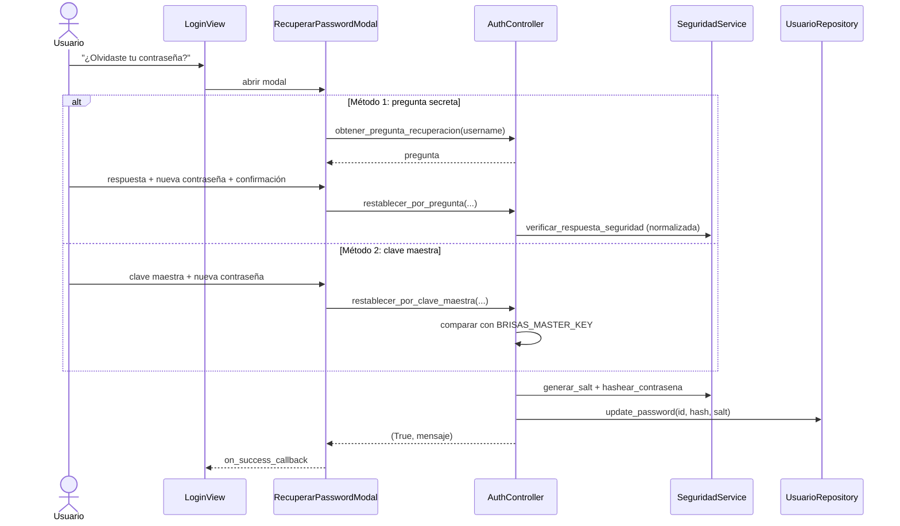

---

## 10. Máquina de estados del semáforo preventivo

Implementada en `MantenimientoController.calcular_estado_alerta` (mismos umbrales en `MantenimientoService`). Se evalúan **km** y **días**; gana el estado más grave.

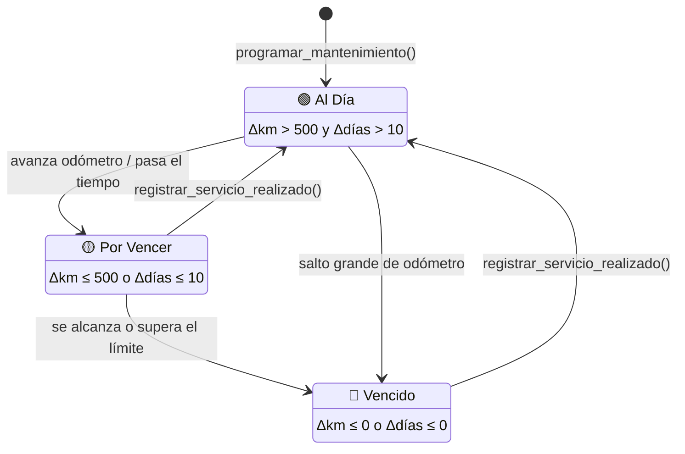

---

## 11. Diagrama de actividad: arranque de la aplicación

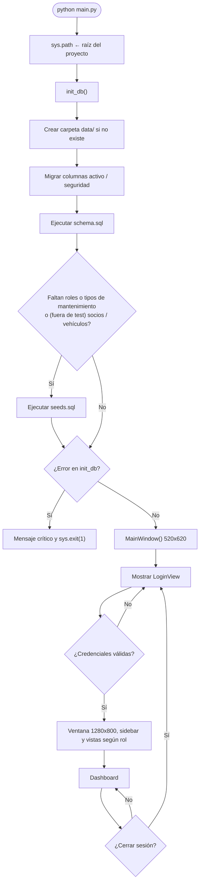

---

## 12. Mapa de navegación de la interfaz

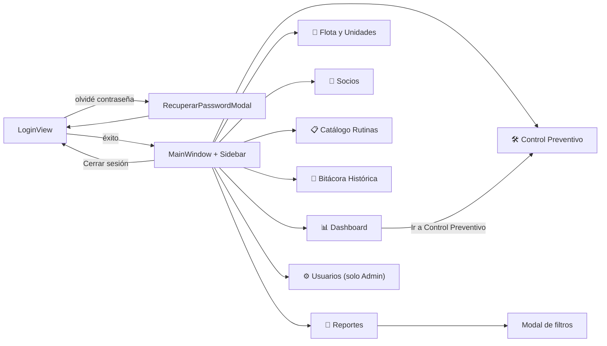

---

## 13. Diagrama de despliegue

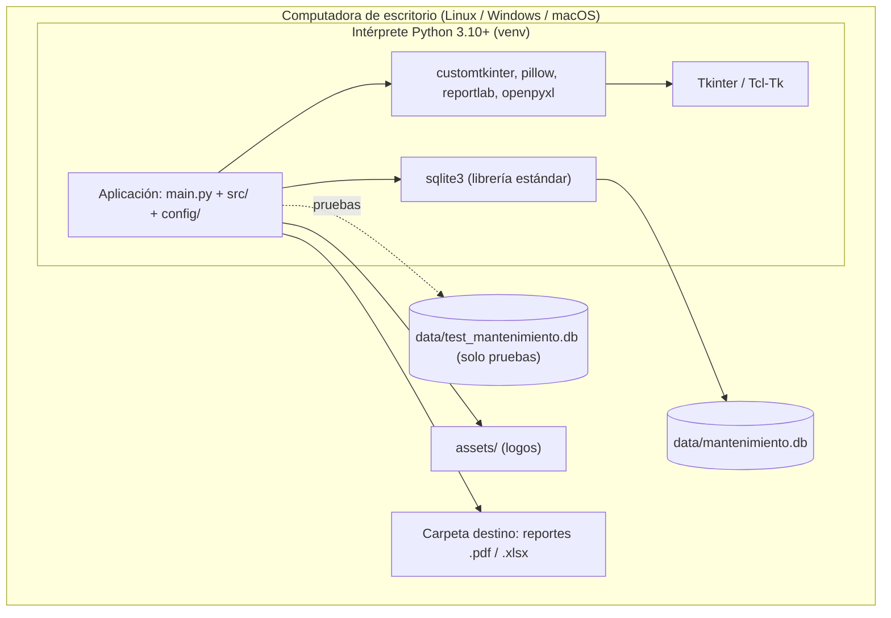

> [!NOTE]
> No hay servidor ni red: es una aplicación monolítica local. El respaldo consiste en copiar `data/mantenimiento.db`.
